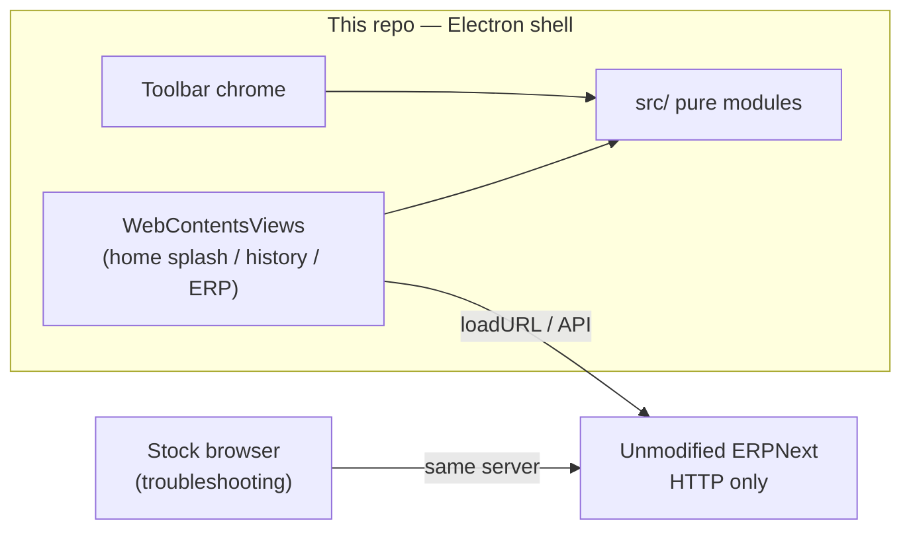

# erpnext-ui-app — handoff & doc lifecycle

> **Active rebuild** (not the museum). Architecture: Electron shell → HTTP → unmodified ERPNext.  
> Process: ADR-0002 · Clean Core ADR-0001 · conventions in `~/agent-harness/memory/conventions.md`.  
> **Product purpose (GitHub / humans):** [README.md](README.md) § Why this exists — UI hygiene, non-enterprise
> PC security (vs browser extensions), document-first muscle memory; target 1080p full / 4K half–quarter.

## Read order (agents)

1. This file — **Architecture map** (below) + where facts live.
2. [README.md](README.md) purpose (if scope/UX tradeoffs come up).
3. Dated working plans (create new when a museum OI tranche is promoted). Each one's status box,
   at the top, says where it stands; read only the plan your work is in.
   **In flight:**
   `implementation-plan-2026-10-19.md` (architecture review — security / stability,
   maintainability, performance, in slices; read only its *How to
   run one review session* and your session's slices) — closing (session 7, R15).
   `implementation-plan-2026-10-24.md` (the navigation matrix, `npm run nav:check`; DC-4) — built;
   rules folded into **Navigation spine** below.
   `implementation-plan-2026-10-12.md` (the Sales Order as the A/R dashboard) — built, being
   dogfooded.
   `implementation-plan-2026-10-03.md` (the trace, OI-041; and the coverage map,
   `npm run dogfood:for-change`) — stages 1, 2 and C built; the pages (3–6) are not.
   `implementation-plan-2026-09-26.md` (navigation audit + Find pages as Doc skins, OI-056; then
   the dogfood papers' follow-ups) — built, being dogfooded; its *After the dogfood papers* is the
   order of what comes next.
   `implementation-plan-2026-09-16.md` (Pay Outstanding corrections, the delay calendar panel,
   the terms-name builder) — built except P4a / P4d (gated on the first live *Create term*), P5
   and P6.
   `implementation-plan-2026-09-08.md` (Payment terms as structured data + the batching
   assumptions) — **superseded 2026-09-16**; closes with 09-16 (its last item is 09-16's P4d).
   **Parked:** `implementation-plan-2026-09-21.md` (the Receiving Scanner, a second client on the
   phone; parked 2026-09-25) — its status box and *Resuming after the pause* say where it stands.
   **Closed:** `implementation-plan-2026-10-21.md` (warm pick lists, OI-185, plus the picker / vendor
   fixes D1–D3 its dogfood found; built and retired 2026-10-21) — folded into **Warm pick lists**
   below; code comments citing "plan 2026-10-21" mean that section. Its open dogfood rows moved to
   plan 10-19 *Dogfood residuals*.
   `implementation-plan-2026-07-29.md` (Vanilla Simplified / OI-086 + Calculator
   OI-018, closed 2026-09-08) — lens architecture folded into **Simplified lens** below; the
   calculator's shipped/remaining split (C0–C3 landed, C4–C5 open) lives on museum **OI-018**;
   the AP credit-memo thread (OI-082 / OI-147 / OI-164 / OI-166 / OI-167) was promoted into the
   2026-09-08 plan as required, **not** dropped.
   `implementation-plan-2026-09-03.md` (Doc Pay skin economic batching / OI-138 ·
   OI-161, MVP 2026-09-08) — flow-geometry contract folded into **Pay Outstanding flow** below;
   `[hidden]`/display and headless-measurement lessons in [docs/gotchas.md](docs/gotchas.md) G7-G8;
   its three financial write paths ran against the live sandbox 2026-09-11 (GL verified); what
   stays unverified is the `erpEval` + IPC hop, plus a fourth path (`createPaymentTermDocs`) that
   has never run live.
   `implementation-plan-2026-08-19.md` (nav instrumentation OI-126/127/128 A,
   2026-09-05) — map folded into **Navigation spine** below; residuals live on as museum
   OI-128 (peek granularity) and OI-040 (concurrent instances, parked).
   `implementation-plan-2026-08-30.md` (AP Doc skin T0–T6 + T1 dogfood, 2026-08-31) —
   runtime lessons in [docs/gotchas.md](docs/gotchas.md); remaining OIs in museum only.
   `implementation-plan-2026-07-18.md` (T1–T4 MVP, closed 2026-07-29, `754b53f`) — the
   lens-prefs rules are in the module map and test table below; the flyout / shell ops it shipped
   (Drafts, diagnose, Feedback, lens prefs) are museum OI-060 / 046 / 048 / 062.
   `implementation-plan-2026-07-15.md` was not closed on its own: it was carried on as 07-18
   (`3279b53`).
4. `docs/beta-slice.md` · `CONTRIBUTING.md`. Discovery / issues inbox (private): museum
   `~/agent-harness/erpnext/doc-shell/open_items.md` — **not** mirrored into this public tree.

---

## Architecture map (thin — scaffold only)

> **Update this section only when** a layer, folder role, or invariant changes.  
> **Do not** update for each feature/OI (those belong in dated plans → then CHANGELOG / OI status).  
> If this disagrees with ADR-0001 or ADR-0002, **the ADR wins**.

### Layers



| Layer | Job | Not its job |
|-------|-----|-------------|
| `src/` | Pure business/helpers (testable offline) | DOM, IPC, `BrowserWindow` |
| `electron/` | Window, views, IPC, load ERP URL | Re-implementing parse/dedupe/health logic |
| ERPNext | Books data + Desk | Patched by us (never) |
| Stock browser | Prove server works without the shell | Product chrome |

### Folder map

| Path | Role |
|------|------|
| `src/*.js` | SSoT for each concern’s **logic** (health, history, route-info, nav-guard, config, money, …) |
| `src/sample-data/` | Pure sample corpus plans + sandbox guard. **Two populations:** `corpus-plan.js` (60-day rotation, ~216 docs) and `reselling-corpus.js` (360-day reselling year, ~2,726 docs, 25 vendors × 25 customers). 🔴 Read `ops/sample-data/README.md` before changing either — the insert order and posting times are load-bearing, not tidiness |
| `ops/sample-data/` | Sandbox-only bench seed runner (`npm run seed:sample`, ~15 min) + **the sample-data contract** (`README.md`): the traced buy-to-sell chain, the monthly cost tiers a FIFO layer is read by, the two ageing rules, and the negative-inventory fixtures |
| `ops/input-count/` | Bill scrape dogfood report (`npm run report:input-count`) |
| `ops/erp-host/` | Optional ERP host scripts: `ensure-erp-up.sh` (docker + ping; no UI); example autofix wrapper |
| `docs/gotchas.md` | Runtime/architecture gotchas from dogfood (bill enrich, ERP IPC, nav) |
| `docs/input-count-gotchas.md` | Measurement gotchas + dogfood checklist before Simplified mockups |
| `docs/erp-unreachable.md` | ERP timeout: host `start-shell.sh` + IT notify/autofix setup in diagnose |
| `docs/erpnext-schema-browse.md` | Safe MariaDB/DBeaver schema browse (read-only, one-hop recipe, Clean Core) |
| `pwa/receiving/` · `src/receiving/` · `ops/receiving-proxy/` | **Parked** (plan 2026-09-21): the Receiving Scanner, a second client on the phone — its pages, its pure logic (also served to the pages as `/receiving/lib/`), and the Caddy front door in front of ERPNext's own web server (frappe_docker untouched). Phone setup: `docs/receiving-phone-setup.md`. Invariant 4 holds: the phone uses the proxy's address for both |
| `tests/*.test.js` | Unit tests; same change as the `src/` they cover |
| `electron/main.js` | Wires views + IPC; calls into `src/` |
| `electron/*.html` + `*-preload.cjs` | Chrome / splash / history UI surfaces |
| `docs/` | beta-slice, commit conventions, **dated** working plans |
| Museum `~/agent-harness/erpnext/doc-shell/` | Reference only — layouts, OIs, lessons |
| ERP source (in Docker) | `docker exec frappe_docker-backend-1 ls /home/frappe/frappe-bench/apps/` — frappe + erpnext + payments + hrms; read-only browse only (Clean Core) |
| MariaDB | `localhost:3306` (Docker port-forward); read-only schema access — see `docs/erpnext-schema-browse.md` |
| Docker compose | `~/erpnext/frappe_docker/` |

### Invariants (do not casually break)

1. **Clean Core** — no edits under vendor `apps/frappe` / `apps/erpnext` (ADR-0001).
2. **HTTP only** — shell talks to ERP over the network; vanilla browser remains a valid fallback.
3. **Pure first** — new behavior lands in `src/` + `tests/` before Electron wiring.
4. **One configured ERP base** — `src/config.js` / env; panels must not invent a second server URL.
5. **AGPL public tree** — process/license in ADR-0002. **Commits:** agents/harness may commit freely on local branches (checkpoints OK). **Pushes:** only 5zorro (5zorro) pushes to GitHub.
6. **One window** (5zorro 2026-09-05) — the whole app stays in the single main window (chrome +
   history rail + a `surfaceMode`-switched `WebContentsView`), never a popup, unless the user
   deliberately spawns a second *all-purpose* window (not a feature-specific one). A tile/action
   that wants its own "page" gets a new `surfaceMode` value + persistent view — a row in
   `src/shell-surfaces.js`, which `place()`, the toolbar's Doc-lens test and the route guard all
   read (see `showFindDoc()` in `main.js` for the pattern) — not a `new BrowserWindow`.
   Doc skins themselves stay scoped to the **transaction-entry forms and each form's own Find
   page** — Purchase Order, Item Receipt, Bill, Payment Entry, Sales Order, Sales Invoice,
   Quotation (Estimate), Journal Entry — not spread across reports, workspaces, masters, or other
   lists (5zorro 2026-09-26: a Find page is the list half of an entry form, not a list skin).
   This governs the **desktop shell**. The parked Receiving Scanner (plan 2026-09-21) is a separate
   client on a phone, not a second window.

7. **A Doc skin is still a form** (5zorro 2026-09-08) — *"it is supposed to still be a form, but
   it is supposed to be easier for humans who handle documents… I don't want to force the lens of
   the form to be read-only to make it more 'document-like'."* What makes a Doc skin
   document-shaped is layout, naming, and what it chooses to show — never the removal of the
   ability to type. The **only** legitimate source of read-only is the document's own state in
   ERPNext (`docstatus`: submitted and cancelled cannot be edited, drafts can), plus fields the ERP
   itself computes. Read-only is a fact the skin reflects, not a lever it pulls for feel. Recorded
   because the opposite instinct is easy to have twice — it was specced into the Doc Pay skin
   tranche's Payment Entry step and had to be reversed before build (plan since closed).

8. **Every door says how it moves the clerk** (5zorro 2026-10-02) — one question per door: *will
   the clerk come back to this page when done?* Yes → **peek** (an errand: create a missing
   master, look at or fix a linked document; the page is parked, Esc returns, nothing is
   discarded — a peek is **not** read-only). No → **navigate** (other work; the unsaved-changes
   gate asks first). Same document, other view → **lens**. From a shell page (the payment board,
   the payment page) an errand is a **detour** (`src/shell-detour.js`): the page stays loaded
   behind, the document opens in the clerk's usual lens, and "← Back to …" (or Esc when the page is
   not using it) returns. **Only a lens click changes the remembered lens** — no door does it as a
   side effect. Every door is a row in `src/doc-doors.js`, and `tests/peek-doors.test.js` fails on a
   door that is missing from the table or does not use the call its kind says. Born of nav
   incident 2026-10-03, where a July-era door navigated away while its neighbour peeked.

9. **The trust boundary** (architecture review, plan 2026-10-19). Only the ERP view shows remote
   content; every shell page is a local file whose preload can save, pay and print. So:
   - **Every view and window is sandboxed, isolated and Node-free, written out explicitly**
     (`tests/view-sandbox-wiring.test.js`).
   - **Shell pages never leave their own file and never open a window** — one
     `app.on("web-contents-created")` guard in `main.js`, decision in `isShellNavAllowed`
     (`src/nav-guard.js`). The ERP view replaces it with its own handlers.
   - **The ERP view warns before leaving ERPNext**, for links and server redirects alike: *Go back*
     (default) / *Open in my browser* / *Continue here* (5zorro: warn, let the clerk click through);
     non-web addresses are never opened (`offBaseNavigation` / `offBaseWarning`).
   - **Every script injected into the ERP view goes through `erpExec()`**, which refuses a page that
     is not ERPNext; the ERP preload's messages count only while the view is on ERPNext. Never call
     `erp.webContents.executeJavaScript` directly — `tests/nav-guard.test.js` fails if you do.
   - **Server text reaches shell pages escaped** (`escapeHtml`, `moneyTextHtml`, `esc`); a converted
     Word file goes through `inertWordHtml()` (mammoth does no sanitising). Shell pages carry no CSP
     yet, so escaping is the only wall.
   - **Files from ERPNext:** only `/files/…` or `/private/files/…` addresses with nothing climbing out
     (`isErpFilePath`); **Open** hands only document types to the OS (`openablePaper`) and marks the
     copy as from the internet on Windows; every name shown or saved goes through `plainFileName()`
     (no right-to-left-override disguises).

### Editing a submitted document (OI-171, built 2026-09-22…26)

ERPNext cannot edit a submitted document, so *edit* means **void and amend**: cancel it, then insert
an editable copy that points back at the original. The shell does exactly what `form.js::amend_doc`
does — `frappe.client.cancel`, `frappe.model.copy_doc(doc, 1)`, insert — and never reimplements
`copy_doc`'s field rules.

Four things about it are worth knowing before touching the code:

1. **The registry is the extension point.** A doctype offers the action by being a row in
   `doc-actions.js`, plus a row saying what cancelling it *costs*. Those costs are all different —
   a Bill's payments are detached, a PO is refused while receipts stand against it, an Item Receipt
   puts stock back off the shelf, a Payment Entry puts the bills it paid back to outstanding — so a
   single "are you sure" would be wrong about three of the four.
2. **Blockers are named, never enforced.** `check_no_back_links_exist` (`document.py:1578`) runs
   *after* `on_cancel` and rolls the transaction back, so a refusal changes nothing and cannot
   strand a document. Letting ERP be the one that says no is both safe and correct; our list of
   what links to what is only an approximation of a rule we do not own.
3. **The half-done state is the dangerous one.** Cancel can succeed and the insert still fail,
   leaving a cancelled document with no replacement. Every result distinguishes that case and names
   the document, because "it failed" would get the bill re-entered and it would then exist twice.
   `voidAmendOutcome` (`src/void-amend-flow.js`) is the one reader of a result, and it knows three
   half-done shapes (review 2026-10-19): cancelled with no copy; cancelled with a copy whose
   **submit** was refused (the copy's name is kept); and **unknown** — a result without
   `cancelled` means the script did not finish, so it is "may already be cancelled", never "nothing
   changed". Only a refusal before anything was sent (`erpEval`'s `notRun`) says nothing changed.
   One void per document at a time (page and main). The batch method change stops at the first
   bill that did not go exactly as asked and offers Try again on the untouched rest. **The same
   reading holds for every write driven through `erpEval`:** a script reports each failure with
   its step (or `cancelled`); a result without one means the script did not finish, so the write
   may have landed — the payment inserts (`step: "uncertain"`, worded by
   `paymentCreateFailureText`) and the just-in-time receipts say so, never a bare "failed".
   The Bill line's bridge Purchase Order follows the same rules (`bridgePoFailureText`; a refused
   submit deletes the draft). And a script whose page **reloads, navigates or crashes** never
   settles on its own — Electron leaves the promise pending for good — so `erpEval` ends every
   pending call when the ERP view commits a load, its renderer goes, or it closes, with a reason
   and no `notRun` (review 10-19 R2-1). Never wrap an `erpEval` write in a time limit instead: a
   timeout cannot say whether the write landed, and the interruption already does.
4. **The amendment's name is not `<name>-1` in general.** `_set_amended_name` (`naming.py:549`)
   increments a trailing counter, so amending `…-1` gives `…-2`; and under
   `Document Naming Settings.default_amend_naming = "Default Naming"` no prediction is possible at
   all. `predictAmendedName` mirrors both and returns `""` rather than guessing.

**What it leaves behind, and what closes it:** cancelling detaches the bill's payments on a site
where `unlink_payment_on_cancellation_of_invoice` is on, and ERPNext keeps **no record** of which
bill a payment paid — the reference row is deleted, `against_voucher` is blanked on the ledgers, and
the change bypasses the ORM so it is not in the version history either. So the pairing can only be
inferred. `payment-relink.js` infers it from the one fact ERPNext's own allocator ignores
(`amended_from`), posts the near-certain ones without asking, and leaves a Frappe assignment on the
payment so an allocation nobody typed explains itself. Re-linking is an *update-after-submit*, not a
second amend; the undo is `Unreconcile Payment`.

### ERP site settings this shell reads (never assumes)

🔴 **Clean Core forbids editing vendor code; it does not forbid configuring ERPNext.** A value in
Accounts Settings or Document Naming Settings is site *data*, written through ERPNext's own form —
it is the surface ERPNext provides precisely so that nobody patches. What the shell must not do is
*assume* one of these values, because every one of them changes what an honest confirm should say.
So each is read live, and each has a defined behaviour at either value.

Everything below is at its **stock default** on the sandbox as of 2026-09-26, so nothing here is a
local deviation — but a second deployment may differ, which is the reason for the table.

| Setting | Stock | What it changes | What the shell does at the other value |
|---|---|---|---|
| `Accounts Settings.unlink_payment_on_cancellation_of_invoice` | `1` | On: cancelling an invoice **detaches** its payments (they stay submitted, unallocated). Off: ERPNext **refuses** the cancel until the payments are cancelled | The void-and-amend confirm says "will be detached" or "ERPNext will refuse to cancel" — opposite sentences, so it is read rather than guessed (`voidAndAmendFacts`) |
| `Accounts Settings.auto_reconcile_payments` | `0` | A **gate**, not an automation: it only enables the *Process Payment Reconciliation* tool, whose cron (`auto_reconciliation_job_trigger`, 15 min) processes PPR documents somebody already queued. Turning it on reconciles nothing by itself | The unapplied-credit advice says whether a loose payment may clear on its own. 🔴 It also allocates **oldest invoice first** (`allocate_entries` over a `posting_date` sort), which is wrong for an amended bill — see below |
| `Accounts Settings.automatically_fetch_payment_terms` | `0` | With the template's `allocate_payment_based_on_payment_terms`, lets `set_payment_schedule` refetch a bill's whole schedule from its order | The batch method change **reads the mode back** after amending rather than trusting the patch stuck (`accounts_controller.py:2658` is the path that would undo it) |
| `Document Naming Settings.default_amend_naming` | `Amend Counter` | Whether an amendment is `<name>-1` / `<name>-2`, or takes a fresh series name | `predictAmendedName` returns `""` under "Default Naming" and the confirm simply does not name the new ID, rather than promising one |
| `Payment Terms Template.allocate_payment_based_on_payment_terms` | per template | Whether payments maintain `paid_amount`/`outstanding` on schedule **rows** | Multi-installment templates the shell creates set it; pre-existing ones may not (`payment-term-plan.js`) |
| `Print Settings.pdf_page_size` | `A4` | The page ERPNext lays documents out on | The print dialog compares it with each printer's paper; a mismatch shows ⚠ and the job is shrunk to fit (never for checks) |
| `Print Settings.allow_print_for_draft` / `add_draft_heading` / `allow_print_for_cancelled` | `1` / `1` / `0` | Whether drafts / cancelled documents print at all, and drafts with a "Draft" heading | `printBlockReason` says it before ERPNext refuses; the shell never works around them |
| `Stock Settings.default_warehouse` | site's own | Where *Receive with this bill* puts stock lines with no warehouse | Read at Save (`bill-receive-facts`); none set → the lines' own warehouses |
| `System Settings.rounding_method` / `currency_precision` / `float_precision` | `Banker's Rounding (legacy)` / blank (the number format's, 2) / blank (3) — **this sandbox: `Banker's Rounding` / blank / `3`** | How ERPNext rounds every stored amount and quantity, and to how many places | The calculator (and the taxes Add box) rounds its result the same way, from the ERPNext page's boot (`calc-site-rounding`, asked again until the site answers), and **says** what it dropped in a yellow tape row: "Rounds to 5.02 — remainder 5/1000" (review 10-19 R13-1, 5zorro 2026-10-25: never quietly). The clerk can pick *Round up* / *Round down* on the tape instead; only the result going into the box is rounded, never a step of the sum. Never set by the shell |
| `System Settings.session_expiry` | `170:00` | Idle time before Frappe ends a session — counted from the last **signed-in request**, in a browser and the shell alike. Stock is about 7 days idle, so a clerk stays logged in overnight | The shell never sets it. It asks "still logged in?" only on events, not on a timer, so this setting is what decides (review 10-19 R4-1). **Recommended: `05:00` or shorter** (5zorro 2026-10-20) — a lunch break stays logged in, a night does not. A per-deployment choice made in Desk; a candidate default if a core patch is ever proposed upstream |
| `site_config.json host_name` (deployment, not Desk) | unset | 🔴 ERPNext's PDF engine (wkhtmltopdf) loads the page's CSS from `get_url()`; inside Docker the browser's address is unreachable from the server and **every PDF fails** (`OSError`, Vanilla too) | Set it to the compose network's frontend (`http://frontend:8080` in frappe_docker). Until then the shell heals: it renders `/printview` to PDF itself and says so (see *Printing*) |

**Why `auto_reconcile_payments` stays off** (5zorro 2026-09-26, after reading the source): it would
not have solved the case that prompted the question, and when it does run it gets that case wrong.
Cancelling an invoice destroys every trace of which bill a payment paid — the Payment Entry
Reference row is deleted, `against_voucher` is blanked on the ledgers, and the change is written
through the query builder so it is not even in the document's version history. ERPNext's allocator
therefore falls back to oldest-invoice-first, which on a supplier with more than one open bill puts
the loose money against the wrong one and leaves the amended bill outstanding — a wrong ledger
*and* still exposed to paying twice. The shell proposes the pairing instead (`payment-relink.js`),
using the one fact the allocator ignores: an amendment carries `amended_from`.

### After an ERPNext upgrade (review 10-19 R12-3)

The shell never patches ERPNext, but it does lean on some of ERPNext's internals by name, and an
upgrade can move them. Nothing fails at once: the unit tests read snapshots and this repo's own
code. So after any ERPNext or Frappe upgrade:

1. **Simplified's field lists:** run `npm run seeds:simplified -- --refresh-meta`, then
   `npm run seeds:simplified`, and commit both. The drift test checks against the snapshot in
   `tests/fixtures/simplified-seed-meta/`, not against the live site.
2. **`npm run dogfood:check`** and the **full `npm run nav:check -- --ongoing`** (app closed, about
   55 min together). These drive the real pages against the upgraded site.
3. **Re-read what is named in code:** the Create ▾ catalog's `cscript` handlers
   (`so-create-menu.js`), Receive Payment's `get_outstanding_documents` (`erp-form-bridge-page.js`),
   the tab DOM and `Form.prototype.refresh` that Simplified rewires (G2, G4,
   `assume-applier-payload.js`), and the ERPNext source facts in the local notes file, which are
   pinned to the sandbox tags. A missing handler or field fails soft, with a message or Vanilla
   as it is (R12-2 logs `simplified-skin-missing`), but it still fails.
4. **The trace's field names:** `ERP_PASSWORD=… node ops/trace/probe-trace-queries.js` asks every
   question the trace asks, read-only, and fails on any field the upgrade renamed (R13-2).

### Warm pick lists (folded from plan 2026-10-21, OI-185, built 2026-10-21)

Why: every keystroke in a link field waited for a round trip through the ERPNext page, and a vendor
search for two (the search, then the vendors' last POs). Rules, with the numbers chosen:

- **What is copied:** Supplier, Customer, Item, Payment Terms Template, Mode of Payment, Project,
  Sales / Purchase Taxes and Charges Template (`WARM_LINK_DOCTYPES`). Not Account (re-labelled by
  company per Bill), not Sales Order (changes all day). Over 50,000 rows a list stays live. A search
  with **any** filter is never answered from the copy. Copy ≈20 MB and a search ≈2 ms at 20k rows.
- **Same order as ERPNext**, or a practised clerk's fast Tab (review 10-19 R5b-1, choice "a")
  picks something else depending on which source answered. Mirrored from `frappe/desk/search.py`
  v16.31.0: which 25 = name/title/search fields contain the text, ranked by where the text first
  appears in the **name**, then `idx desc`, then the list's `sort_field`/`sort_order`; shown as
  names starting with the text first, then the rest, each in plain string order (capitals first);
  vendors then re-ranked by PO activity (OI-131). The copy is `search_link` itself (empty text, no
  page limit) plus each row's rank from one ordered `get_list`. Proven 54/54 against live.
- **Freshness:** loaded 2 s after a Doc open (the ERPNext page is moving to the same document at
  that moment and cut every load off; a cut-off load retries once 3 s later); "changed since" on
  every Doc open (≥ 10 s apart), right after a peek returns (Create Vendor…), and at most once a
  minute while searching; a count mismatch reloads the list; *Refresh* under the dropdown reloads
  it; a miss asks ERPNext at once; logging out or another user drops every copy.
- **Only `frappe.xcall`** in ERPNext-page code: `frappe.db.get_list` never settles on a server
  error (gotchas G19, the likely mechanism of plan 10-19 R5b-4).
- **Typing pause:** 280 ms before a live search, 40 ms after a copy answer.
- **Trail:** `focus-debug.log` `link-pick` / `link-pick-key` / `link-held` / `link-held-replay` /
  `link-held-cancel` carry `typed=… list=… rule=current|exact|held|chosen picked=… src=copy|live`;
  `nav-debug.log` `link-list` lines for load, check, reload, refresh, miss (once per run of
  misses), drop and failure; `link-missing` for a vendor checked and not found. A focus *incident*
  copies the trail with those values redacted to lengths (`typed=(12 chars)`,
  `redactFocusDetail`) — incidents promise no field values; the local log keeps them.
- **Deadlines:** every ERPNext-page call here is raced — list load 30 s, check 20 s, the vendor
  check 5 s (then "could not tell", which never blocks). A vendor pick waits on that check before
  anything opens, so without one a stalled page would make the pick do nothing.

Fixes from its first dogfood (D1–D3):

- **D1 — an open dropdown never outlives its page.** Leaving the Doc surface (every switch goes
  through main's `setSurfaceMode`, which sends `doc-surface-left`; the page's own window blur does
  not fire for a view switch inside an unfocused window), painting a different document, or the
  window losing focus closes it. One left open kept its old list, and a vendor deleted meanwhile
  was picked from it.
- **D2 — a vendor is checked live before the Bill, PO or Item Receipt uses it** (`doc-link-exists`;
  never the copy, which is what can be stale): on a vendor pick, a typed vendor's commit, and a
  source open other than the pick's own. Missing → a banner across the top
  (`missing-vendor.js` words it, `missing-vendor-ui.js` checks and shows it on both pages), the box goes
  back, nothing opens or is written, and the copy runs a check. A vendor write that answers after
  the clerk has *typed in another field* no longer opens the source picker. The PO page got this
  late (review 10-19 R5b-5): without it, a made-up vendor was written to ERPNext and its sources
  opened 10 s later in the middle of the clerk's typing.
- **D3 — waits inside the ERPNext page yield a real turn.** `frappe.after_ajax` calls back at once
  when idle (gotchas G20), so `afterAjaxQuiet` let the vendor-settle loop spin for its whole 12 s
  deadline with the page frozen, since 2026-09-02. One-off waits now yield with `setTimeout` 0; the
  two polling loops pace themselves (50 / 100 ms).

### Printing (folded from plan 2026-09-26 "Printing" / "Printer hardening", built 2026-10-03)

How Frappe prints, read from v16: its **Print** button `window.open`s `/printview?…&trigger_print=1`
(the page calls the browser's print), **PDF** opens `frappe.utils.print_format.download_pdf`
(server-side wkhtmltopdf), list **bulk print** uses `download_multi_pdf` (≤ 500, one merged file,
`{doctype: [names]}` mixes doctypes). Every render writes an Access Log entry. In Electron each
`window.open` would be a popup — the bug 5zorro first met.

1. **ERPNext renders, the shell delivers.** Pages from `/printview`, PDFs from ERPNext's endpoints,
   with ERPNext's Print Format / Letter Head / print style. The shell has no second layout.
2. **Never a popup, never a page change.** The ERP view's window-open handler hands print URLs to
   the print service (Vanilla's own buttons included); `print-run` / `print-queue-run` are in-place
   actions the doors test checks.
3. **Self-healing, sorted by who can fix it** (`diagnosePrintFailure`): *rule* (ERPNext said no —
   passed through, never worked around), *session* (log in), *engine* (ERPNext's PDF engine broke —
   the shell renders `/printview` with `printToPDF` itself and shows IT's fix), *printer* (gone,
   refused — said up front, jobs stay queued). The shell never changes the server.
4. **Printer path.** Chromium's silent print on Linux refuses CUPS printers ("Invalid printer
   settings"); the document's PDF then goes to the OS: `lp` (Linux / macOS), SumatraPDF (Windows,
   when installed). **Print as image** is on by default (remembered): pages flattened onto white at
   240 dpi (`electron/print-raster.html`), so a driver only sees pictures. A paper mismatch with
   `pdf_page_size` shows ⚠ and shrinks to fit. Sent jobs are watched (CUPS `lpstat`,
   `printer-state-reasons`) with *Check again* / *Stop watching (Esc)*; every print call has a
   90-second deadline.
5. **Checks are exact**: no shrink, no image conversion, no scaling — alignment on stock depends on it.
6. **One app-wide print queue**; a payment made by check joins it. Printers: the 3 most recently
   used sort first, each with its full name and address.
7. **Save as one PDF** (Papers): pictures flattened and held to one page; Word keeps its pages;
   spreadsheets only when they fit one page (45 × 10), otherwise "open it in Excel".

Not built yet: Cheque Print Template + alignment page + spoiled-check path; Find-page multi-select
into the queue; the queue survives a restart. WSL / Linux setup: `ops/wsl-printing/README.md`.

### A Bill line assigned to Sales Orders — split by need (review 10-19 R6b-4, 2026-10-22)

*Assign…* on a Bill line makes a **bridge Purchase Order** for the line's item, so the Sales Orders
are bought for. The rules (`src/bill-line-allocation.js` `planSalesOrderSplit`, `src/split-by-weights.js`):

- **Weights are need:** each Sales Order line's open qty, `qty − ordered_qty / conversion_factor`
  (ERPNext's own `make_purchase_order` figure). The split uses the one rounding rule shared with the
  charge allocation (`splitUnitsByWeights`: rounded down, leftover units by largest remainder, ties
  to the earlier) — whole units for a *Must be Whole Number* unit, thousandths otherwise. Qty is a
  decimal in ERPNext; only those units refuse fractions.
- **An order On Hold or Closed needs nothing**, as ERPNext counts it (`get_reserved_qty`, the Bin's
  Reserved Qty, leaves such orders out; Desk offers no Purchase Order from one, though the PO server
  would accept the link). The Assign list never offers one; an order paused after it was picked takes
  nothing, shows "On Hold — not counted", and makes the box ask.
- **Each PO line links the Sales Order *line*** (`sales_order_item`), or ERPNext never counts it as
  ordered. Once linked, ERPNext refuses ordering past that line's qty (*Over Delivery/Receipt
  Allowance*, 0 % here), so what the orders do not need is **one more PO line for no order** — into
  stock.
- **Anything but an exact fill is a costing assumption** (the rest of an order comes from stock, at
  stock's rate or a negative-stock fallback): the dialog stops on **"Costing Assumptions!"** with the
  per-order table, a *Fill from stock* tick per order, and "Okay, I still want to do this". The Okay
  carries the plan's key; if the orders changed since, the box is shown again rather than made.
- **The decision is kept** as a Comment opening `Costing assumptions:` (`COSTING_TOKEN` — load-bearing,
  the shell finds them by it) on the bridge PO and each Sales Order that took part, with a `data:`
  line `parseCostingNote` reads back — so the same box (`src/costing-box-ui.js`) can be drawn from
  the Sales Order later. An order's open qty at that moment cannot be worked out afterwards.
- **The Sales Order's look-back** (step 8): a line a Bill's split filled ends its Sources cell with
  a *Costing* chip (×N when several bills split onto it), which opens each note's box read-only,
  newest first, this order's row in bold, with a peek at the bridge PO. The notes are read through
  `frappe.desk.form.load.get_docinfo` — anyone who can read the order may read its Comments there,
  while listing the Comment doctype needs System Manager. `costingNotesByLine` places a note by the
  `salesOrderItem` its rows name; a note on an order with no line for the item places nothing.

### Extension points (where new work plugs in)

| Capability | Pure module(s) | Electron surface |
|------------|----------------|------------------|
| DB / reachability | `health.js`, `diagnose.js`, `health-remediation.js` | Toolbar health + diagnose; IT notify/autofix prefs in userData only. The health ping (5 s, no cookies) is not the login check: "still logged in?" is asked only at launch, when health changes, on window focus, on an ERP page load and after a refused signed-in read (`loginCheckOnHealthChange`, `loginCheckAfterRefusal`) — every signed-in request extends a Frappe session, so a timer would stop the site's *Session Expiry* ever running out (review 10-19 R4-1) |
| Recent history | `route-info.js`, `history.js`, `history-nav.js`, `peek-stack.js`, `doctype-labels.js` | Left `history.html` rail (peeks fold under their parent's row as a dropdown, OI-128 A; collapsible) |
| Submitted this session | `submitted-docs.js` | One rail row + running count → `submitted-dropdown.html` panel; the way back after submit-and-move-on (Drafts is `docstatus 0` only, Recent keeps one row per doctype). OI-162 — shipped 2026-09-05 |
| Allowed navigation | `nav-guard.js` | `main.js` will-navigate / window-open |
| Nav intent guard | `erp-nav-intent.js` | Arm/clear around an intentional ERP nav so a late event from the page we left cannot rewrite `currentRoute` (G6) |
| Nav incident log | `nav-incident.js` | DB ping diagnose → **Nav issue** (Ctrl+Shift+M); `userData/nav-incidents.log` |
| Chrome UI state | `chrome-state.js` | Toolbar lens chip (from the **live** ERP path, not the believed route) + Recent rail width/collapse |
| Money helpers | `money.js` (e.g. nickel) | Later Doc tools |
| Pay Outstanding flow | `outstanding-bills.js`, `pay-flow-geometry.js`, `payment-batch-economics.js`, `payment-batch-prefs.js`, `check-run-schedule.js`, `bank-business-days.js`, `pay-flow-sort.js`, `pay-flow-focus.js`, `flow-node-density.js` | `pay-outstanding.html` (vendor cards: invoices → schedule → suggested payments) + `payment-doc.html`; check drawer via `check-doc-*` |
| **What a skin can *do* to a document** | `doc-actions.js` (the registry: which actions a doctype has, whether each applies now, and what cancelling one costs), `void-amend-flow.js` (the single-document sequence, shared by four skins) | Edit (void and amend) on the Bill / PO / Item Receipt chrome (`btn-void-amend`) and on the Payment Entry check face (`check-doc-void-amend`) |
| Changing a vendor's payment method after the fact | `mode-change-plan.js` (collapses an installment selection into one amend per *invoice*, and says what the batch will cost) | **Method…** panel on each Pay Outstanding vendor card |
| Payments an amendment detached | `payment-relink.js` (proposes which bill a loose payment belongs to, from `amended_from` + an exact amount match; decides what may post unasked) | The vendor card's *unapplied* chip and *auto-linked · review* badge |
| Launcher / workflow Home | `home-tiles.js` (`HOME_GROUPS`); `vendor-process-flow.js` / `customer-process-flow.js` arrange the Vendors / Customers groups as swimlanes | `home.html` Doc Workflow Home (museum-style tiles) |
| Desk hatch — A/R vs A/P at a glance (OI-125) | `doc-wash.js` (`mergeDocWashPrefs`, `washPatternSyncScript`); `doc-wash.css` `--hatch-desk` | One global setting, the toggle on Home; `main.js` stores it in `userData/doc-wash-prefs.json` and pushes it into every shell page. A page's localStorage is only a mirror |
| Where a route opens | `nav-destination.js` (`resolveOpenTarget`, `lensPrefKey`) | Every door in `main.js` asks `openTargetFor()` and hands the answer to `openResolvedTarget()` — Home tiles, Recent/Drafts/Submitted, both lens tabs, Find, the hijack (plan 2026-09-26 F2) |
| Shell pages | `shell-surfaces.js` (`SHELL_SURFACES`) | One row per `surfaceMode`: its view, whether it is the Doc lens, whether it owns its address |
| Find pages (OI-056) | `find-skin-registry.js` (`FIND_SKINS`); `find-skin-query.js` (the page's searches as a Frappe list query — Vanilla's `creation desc` order, part-of-value matching, party id *or* name) | `find-doc.html`, `surfaceMode: "find-doc"`, `showFindDoc()`; rows and the peek are read over HTTP by main (`find-doc-list` / `find-doc-peek`, `/api/resource`, never the ERP page). A doctype gets a Find page by gaining a registry row |
| Dogfood DevTools | — (IPC only) | Toolbar **ERP console** → `openDevTools` on ERP (or chrome/home/hist) |
| Doc terms | `doc-terms.js` | Bill / Home labels (plain-English: Bill, Vendor, Item Receipt, Estimate, Invoice). Vanilla keeps ERPNext's words |
| A/R Doc skins (plan 2026-09-26 A1) | `estimate-map.js`, `sales-order-map.js`, `sales-invoice-map.js`, `receive-payment-map.js` (layouts as data), read by `sales-doc-map.js`; `doc-skin-registry.js` `DOC_FORM_MAPS` / `docFormMapFor` is what the page and `main.js` ask instead of `profileId === "po"` | More `doc-form.html` layouts. Receive Payment is `layoutOnly` (it shares Payment Entry with Pay Bills): reached by layout key, never by `profileByDoctypeKey` — see *Two registries* |
| Bill map (M3a) | `bill-map.js` | Header/item projectors; Amount Due checksum |
| Dirty-gate (M3b) | `dirty-gate.js` | Nav prompt classifier (wire in M3c) |
| Doc ↔ Vanilla form bridge | `erp-form-bridge.js` + `electron/erp-form-bridge-page.js` | Event-driven `waitForForm` / `setRow` / `setHeader` (Bill template → PO/IR) |
| Lens prefs | `lens-prefs.js` | Per-doctype last lens; default **doc**; persisted `lens-prefs.json` across restarts |
| Lens context | `lens-context.js` (`DOC_SKIN_INDEX` + `ready`) | Doc tab only when indexed **and ready** |
| Simplified skin (thin-inject) | `assume-applier-payload.js`, `assume-core.js`, `simplified-seed-profiles.js` | `ensureSimplifiedSkin` / `removeSimplifiedSkin` in `main.js` — injects into the **live Vanilla form**; a new doctype ships as a seed profile, not new shell code |
| In-field calculator | `src/calc/` (`calc-engine.js`, `attach-field-calc.js`, `field-calc.js`, `back-in-amount.js`, `session-history.js`) | Doc form numeric fields (Bill / PO / IR) + left-rail Calculator history; 24h prune in `nav-state.json` |
| Link search (T1) | `link-search.js`, `vendor-activity.js`, `link-picker-open-set.js`, `link-list-cache.js`, `missing-vendor.js`, `missing-vendor-ui.js` | Normalize `search_link` rows; idle/never-PO vendors sink (OI-131). A picker adds **no** page-wide listener of its own: the line tables are rebuilt on every paint, so per-picker `window`/`document` listeners piled up all day (review 10-19 R5-1). Page-wide resize / scroll / click-outside go through the one open-dropdown set. **Tab / Enter never commits from a list fetched for other text** (review 10-19 R5b-1, `linkPickerCommitPlan`): only the newest search paints; an exact match of the typed text is taken at once; otherwise the key is held and replayed when the list for the typed text is in, so a fast Tab does what a slow one would — **also before the box's first list has come back** (a search pending for the typed text holds the key; without that, a fast typist's first Tab in a box left the half-typed text behind; review 2026-10-22). *Create …* (Vendor, Item, …) is offered only when nothing matches, so a held Tab lands on it only then — warm list or not. A held Tab whose search fails, or finds nothing with no *Create* row, stays in the box showing why; the next Tab leaves. Esc cancels a search still on its way. **A pick owns its write:** the box's own `change` (it fires on leaving the box after typing, and a vendor pick moves focus into the source picker at once) does not write the picked value again (`linkPickOwnsCommit`, `data-link-picking`) — the doubled vendor write answered ~9 s later and its repaint dropped the clerk out of the line they were typing; the PO's vendor-pick repaint keeps the clerk's place too. **Warm pick lists** (plan 2026-10-21, `link-list-cache.js`): main keeps a copy of 8 rarely-changed lists (vendors, customers, items, terms, methods, projects, tax templates) per logged-in user and answers *unfiltered* searches from it **in ERPNext's own order** (which 25: where the text sits in the name, then `idx`, then the list's sort; shown prefix-first then string order; vendors re-ranked by PO activity) — a copy that ordered differently would change what a fast Tab picks. A miss asks ERPNext; a Doc page opening runs "changed since" (count mismatch → reload); *Refresh* under the dropdown reloads; a login change drops the copies. ERP-page calls there use `frappe.xcall` only (`docs/gotchas.md` G19). **An open dropdown never outlives its page:** leaving the Doc surface (main's `setSurfaceMode` → `doc-surface-left`), a different document painted, or the window losing focus closes it (plan 2026-10-21 D1). **A vendor is checked live before the Bill, PO or Item Receipt uses it** (`doc-link-exists`, not the copy): a missing one gets a banner and opens no sources (D2, R5b-5). Waits inside the ERPNext page yield a real turn — `frappe.after_ajax` calls back synchronously when idle (G20) |
| Doc skin UI (M3c–d + T1) | `bill-map` + `electron/bill.html` | Doc Bill; lines `set_value`; ▾ Link pickers |
| **Fixed** Source modal after vendor | `docs/bug-bounty-source-modal-vendor-pick.md` | HAR: PR Item 403; enrich removed (`4c8f72b`) |
| **Fixed** Setup peek return (OI-112 class) | `docs/bug-bounty-setup-peek-return.md` | Vanilla Create-new-Account; Esc/Recent parent now in-SPA |
| Bill feature catalog (museum↔alpha) | `src/bill-feature-catalog.js` + `tests/bill-*.test.js` | Pure contracts; CI fails if built features lack tests |
| Doors: peek / navigate / lens / detour (invariant 8) | `doc-doors.js` (`DOC_DOORS`, `IN_PLACE_ACTIONS`), `shell-detour.js` | Every Doc-skin door is a row; `tests/peek-doors.test.js` holds `main.js` to it. A detour (payment board → the bill a payment pays) keeps the shell page loaded; "← Back to …" in the top bar, or Esc. From a Doc page to another Doc-skinned document (the bill's PO, receipt, Sales Order) the same back control returns, after the unsaved-changes gate asks at the door (`openDocErrand`; temporary until OI-040's windows) |
| Peek sessions follow renames | `peek-stack.js` (`renameInPeekStack`, `renameInPeekLinks`), `erp-route-hop.js` (`renamed` = Frappe's `frappe.model.new_names`) | A draft saved during a peek keeps its place under its saved name |
| Which number leads (OI-170) | `doc-number-pref.js` (`THEIR_NUMBER` per doctype — Bill `bill_no`, PO `title` logbook, IR `lr_no`, SO `po_no`, SI its Sales Order(s), Payment `reference_no`), `doc-number-ui.js` | One app-wide setting (`doc-number-prefs.json`), the File group's **No.:** button, the banner's identity line, Pay Outstanding's invoice nodes. Never leads with a blank; the other number always beside it |
| Printing | `print-service.js` (URLs, popup classifier, queue, remembered choices, `diagnosePrintFailure`, paper / plan / job-status helpers), `print-dialog-ui.js`, `print-raster-page.js` | In place, never a popup — see *Printing* below. `print-prefs.json` |
| Papers — compare pane | `compare-papers.js`, `compare-pane-ui.js`, `sheet-preview.js` (CSV / .xlsx one-page tables), `zip-store.js` | **Papers** on every Doc skin: the document's ERPNext attachments (optionally its PO's / receipt's) stacked beside it as one column (PDF.js, mammoth); drop to attach (Frappe `upload_file`); Save all as ZIP / as one PDF. Runtime deps `pdfjs-dist`, `mammoth` |
| Draft payments on the board | `payment-drafts.js` | Pay Outstanding's *Draft payments* panel (Open / Submit / Delete) and a warn advisory on each bill a draft covers — a draft posts nothing, so the AP report shows its bills unpaid |
| Receive with the bill | `bill-receive-ask.js` | Doc Bill Save / Submit asks when stock lines have no receipt: Update Stock (+ `set_warehouse`), bill only, or don't ask again (`bill-receive-prefs.json`); Simplified annotates ERPNext's *Expense Head Changed* |
| Line tables take room only when needed | `item-table-layout.js` (`naturalTableWidthPx`, `lineTableWidthPx`), `item-col-resize.js` (`growSectionToNeed`) | Items / taxes sit on the card and grow to the right only when content needs it, stopping at the window or the Papers pane |
| The trace — document links and the views over them (plan 2026-10-03, OI-041) | `trace-links.js` (the link registry: which field on which document says "came from"; paper vs posted dates), `trace-graph.js` (line-to-line links, whose story a line belongs to, landed cost read from ERPNext, charges in no item's cost + ⓘ advisories, gaps), `trace-lifecycle.js`, `payment-timeline.js`, `trace-query.js` (fetch up and down over `/api/resource`, child-table filters) | No page yet (stages 3–6). `ops/trace/probe-trace-queries.js` proves every question read-only on a live site; `ops/trace/export-trace-fixture.js` exports a fixture from a **copy** of a backup. Mockup: `docs/mockups/bowtie-trace.html` |
| Coverage map — what a change needs tested and dogfooded | `architecture-families.js` (families → modules, pages, e2e; papers by `touches`) | `npm run dogfood:for-change [base]`; held to the tree by `tests/architecture-families.test.js` |

Toolbar **Home** → **Doc Workflow Home** (tiled shell page, not ERP Desk).
**Vanilla skin** → ERP `/desk`. Site root `/` is a tile under Shell.
ERP Desk itself is unmodified — it will not show our tiles (by design).

### Navigation spine (OI-126 map — folded from the 2026-08-19 plan)

One window, one ERP WebContents SPA, one `surfaceMode` (`home | doc | erp`), one
`dirtyState`. **Approach A only:** Recent draws nested peeks under the parent Doc on that
single view. Approach B (overlay WebContents) is out; C (warm pool of N SPAs) stays parked
on museum **OI-040**.

| Vanilla Desk job | Shell mechanism | Status after the OI-127 incident corpus |
|------------------|-----------------|------------------------------------------|
| Same-SPA hop to a master, typing survives | soft-peek + Doc park/rebind | **Confirmed** — OI-112 strike 1 closed; rebind misses not seen since |
| Peek a Link without leaving the form | coarse surface swap + peek tree (depth 1) | **Open** — in-Doc overlay is still museum OI-128 |
| Second live client (browser tab) | singleton `dirtyState`; unmanaged `window.open` | **Open** — parked on OI-040; incident snapshots count guest windows |
| Browser Back | Esc dismisses peek; Recent is a deduped resume | **Confirmed** — do not mash Back into Recent |
| "Where am I?" (toolbar lens chip) | `toolbarLensId()` from the **live** ERP path | **Repaired 2026-09-05** — believed route could lag the page (G6) |

**Who is a peek parent (2026-09-30, plan 2026-09-26 N1).** Peeks are driven by the ERP page's
own report of each Frappe route change (`erp-route-hop.js`: the form left, whether it had unsaved
changes, `frappe._from_link`), never by the shell's remembered previous route. A parent is the
form Frappe names as the caller (a Link field's *Create a new …*), else a form left with unsaved
changes — any doctype. A Doc skin's own peek buttons keep the Doc document as parent. Depth is
one; a hop onto the parent or a child is a return and changes nothing. Recent folds children
under the parent's row; a child picked there opens as a peek of that parent, and Esc steps back
in place — never by reloading, which would drop an unsaved draft. Rules: `peek-stack.js`.

**`currentRoute` is a claim, not a fact.** It is set optimistically at nav time and
reconciled from browser events, so anything user-visible that reads it (lens chip,
Simplified injection gate, Recent rows) must tolerate it lagging — see `docs/gotchas.md` G6.
Guarding those events is `erp-nav-intent.js`; the guard must always resolve to arm **or**
clear, never "leave the last one armed".

**The navigation matrix pins all of this (plan 2026-10-24).** `npm run nav:check` drives every way
to move — start (Home tile, toolbar lens, Recent, Drafts, a link in the ERPNext page, a Find page,
the board) × the Bill's state (new typed, draft clean / typed, submitted) × move (Desk, the other
lens, an errand saved / abandoned, a peek, another document, an ERPNext reload) — and judges each
cell on *lands*, *typing* (never lost without a question), *back* and *focus* (`src/nav-spine.js`);
`-- --ongoing` adds a scripted long session and the cruft check on the rail's lists
(`src/nav-cruft.js`). **When to run it (5zorro 2026-10-24):** after a navigation change, only the
cells it touches — `NAV_ONLY=<start>/<state>/<move>,…`, one start (`npm run nav:check -- drafts`,
2–4 min) or the probe that reproduced the bug; the **full** `npm run nav:check -- --ongoing` (~30 min,
the app closed the whole time) only when 5zorro says he is about to push. A full run blocks him from
opening the app, so it is not the default. A cell that changes is a finding to explain, not a test
to update. The rules it
fixed (2026-10-24):

- **Opening another document from a Doc page asks** about unsaved typing, wherever the door is
  (Recent, Drafts, Find, a link): `showDocForm` gates unless it is the same document or the caller
  already asked (`skipDirtyGate`, New). It used to skip the gate on any Doc page (N-1).
- **A typed new document is not carried across lenses**; the gate offers *Save draft, then
  continue* and Vanilla opens that saved draft (5zorro: JIT entry of PO / IR makes carrying partial
  typing a losing fight). `open-vanilla-skin` reads the saved name from the form after the gate.
- **Desk has a route guard of its own** (`DESK_INTENT` in `erp-nav-intent.js`): while a load of Desk
  is under way, a form URL is a late event from the page being left. Without it, Discard on a new
  Bill followed by Desk pulled the clerk back onto a blank Bill (N-3, 3 in 20 tries).
- **An ERPNext reload under the Doc page is said, not asked** (DC-4, 5zorro: match Vanilla). The
  shell never reloads that page itself, and Chromium skips Frappe's "leave?" for typing done in the
  Doc page (`docs/gotchas.md` G23) — so after a load the shell did not start, the Doc page repaints
  from the reloaded form and says what was lost; during a Save it says the save may or may not have
  landed (`erp-reload-notice.js`). Vanilla keeps nothing across a reload, and nor does the shell.
- **The rail's rows are pruned at login *and* when Home is shown** (at most once a minute,
  `shouldPruneOnHome`): a draft deleted in a browser tab mid-session used to stay on Drafts until the
  next start (N-6, found by the long-session run). A route's record is decoded before ERPNext is
  asked (N-4).
- **A Vanilla save reaches Drafts on the route poll (750 ms)**; every shell load of the ERPNext page
  (`loadErpUrl`) takes it first, capped at 1.5 s — a save followed at once by a load that replaced
  the page lost its Drafts row (N-5).
- **Any load of the ERPNext page that lands under the Doc page repaints it** — unless the Doc page
  started it: an ERPNext reload (said, DC-4) and a Vanilla open overtaken by a quick Doc-tab click
  (silent, N-7). `loadErpUrl` records the surface the move was *asked from*, before its drain.
- **Recent keeps one row per doctype — a feature.** The way back to a submitted document is the
  rail's *Submitted* section, once each, sorted by a per-clerk switch: by submission (default) or
  by when last viewed — viewing counts in either lens and through any door (5zorro 2026-10-24: not
  one order for every user). `src/submitted-docs.js`; the choice is `submittedSort` in
  `nav-state.json`.

**Every surface claims a route.** A `surfaceMode` that renders a document must set
`currentRoute` (and push its Recent row) the moment it is shown — an ERP navigation does this
for free, a `loadFile()` surface must do it by hand via `noteShellDocSurfaceRoute()`, using the
same `/app/…` route the Vanilla visit would use so both lenses share one history slot. The two
Payment Entry Doc surfaces skipped it and went missing from Recent, the lens chip and their own
incident snapshots — `docs/gotchas.md` G9.

**Two registries, one question.** `lens-context.js` (`DOC_SKIN_INDEX`) is the SSoT for *what has
a Doc skin*; `doc-skin-registry.js` (`DOC_SKIN_PROFILES`) only knows the doc-form.html layouts.
Nav paths must ask the former (`resolveDocSkinTarget`) and use the latter only to dispatch a
doc-form shell — asking the subset is how a remembered Doc lens gets silently downgraded to
Vanilla (G9). Dispatch goes by the target's **layout key** first (`docFormProfileForTarget` in
`main.js`), because one doctype can have two Doc pages: Payment Entry is Pay Bills *and* the A/R
Receive Payment form, and `profileByDoctypeKey("payment-entry")` deliberately answers null.

**One question, one answer** (plan 2026-09-26). "Which page does this address open on?" is
`nav-destination.js` `resolveOpenTarget`, for forms and lists alike. A door that re-derives it
from `profileByDoctypeKey` or `surfaceMode === "doc"` is the G9/G10 bug waiting for the next kind
of skin. Three rules ride with it:

- **A list remembers its own lens** (`purchase-invoice:list`), apart from its form, default Doc.
  Choosing Vanilla on Find Bills never changes how Bills open.
- **Lists are never hijacked.** A Vanilla list stays Vanilla however the clerk got there; the Find
  page opens only from a Find button, the Doc tab, or a Recent row. Vanilla stays the escape hatch.
- **A hidden page does not narrate.** While a shell page is on screen, address changes reported by
  the hidden ERP view must not move `currentRoute` or Recent (`ownsRoute` in `shell-surfaces.js`:
  Find, Pay Bills, a payment — not the Doc form, whose hidden ERP form *is* its document).

Filters travel in the address — `/app/<doctype>?field=value` is applied by Frappe's own list
(`router.js` `set_route_options_from_url`), so nothing needs typing into its page.

**Persistence contract** (`userData/nav-state.json`): Drafts, Calculator history, Submitted
docs and the rail's collapsed state survive restart (calc and submitted rows restored from
disk are marked *previous session*, so the "this session" counter stays honest).
**Recent does not** — it is this session's trail by design, so the flyout legitimately opens
empty after a restart while Drafts still lists work in progress.

**Lens tabs are earned per page.** Vanilla is always there — it is the ERP itself. Every
other tab must be earned by the page in front of you (`chrome-state.js` `lensTabsFor()`;
the toolbar renders the answer, it never guesses — which tab is *lit* is `lensTabEmphasis()`
under the same rule, after the toolbar re-derived it and lit the wrong one, G10):

| Page | Tabs |
|------|------|
| Bill record | Vanilla · Simplified · Doc |
| PO record | Vanilla · Simplified · Doc |
| IR (Purchase Receipt) record | Vanilla · Simplified · Doc |
| Estimate (Quotation), Sales Order, Invoice (Sales Invoice) record | Vanilla · Doc |
| New payment, direction Receive | Vanilla · Doc (the Receive Payment form; Pay → the Pay Bills dashboard) |
| List with a Find page (Bills, POs, Item Receipts, Payments, Estimates, Sales Orders, Sales Invoices — incl. Report/Kanban views) | Vanilla · Doc |
| Desk, dashboards, other lists, masters | Vanilla only |

(2026-09-05: Simplified's seed now covers all three anchored doc-skin doctypes, not just
Bill — see `simplified-seed-profiles.js`. Any future doctype with a Doc skin but no seed
yet stays Vanilla + Doc only, same rule as before.)

- **Simplified** needs a seeded doctype *and* an open record — availability derives from
  `SEED_PROFILES` via `lens-context.js` `hasSimplifiedLens()`, so shipping a seed lights up
  the tab and there is no second list to forget.
- **Doc** appears for a Doc-skinnable record, or a genuine **one-step** return to one (a
  parked Doc or a peek parent that is itself a Doc form — peeking a master while editing a
  Bill keeps it). A peek parent that is just another Vanilla page does not qualify.
- Which route answers "what am I looking at" differs by surface: on ERP the **live** page
  wins (`currentRoute` lags), on the Doc surface `currentRoute` wins (the hidden ERP view
  trails it — reading the live path there reports the *previous* document).
- Clicking **Vanilla** while already on a Vanilla page with no other lens **stays put**; it
  does not bounce to Desk.

OI-112 — always-on Doc tab narrowed 2026-09-05; rule extended to the whole toolbar.

### Simplified lens (folded from the 2026-07-29 plan, closed 2026-09-08)

Simplified is **thin-inject**, decided 2026-09-06 after building both mockups: the shell injects
`assume-applier-payload.js` into the **live Vanilla form** and hides / dims / skip-tabs its way to
the clerk path. Ground-up rebuild was rejected — Doc already owns the rebuilt clerk path, and the
injection core is reusable against **other Vanilla form-entry sites**, which a second bespoke form
would not be. The rejected mockup's one good idea — growing a skin's field coverage toward Vanilla
parity — survives as museum **OI-163**, aimed at the **Doc** skin, and is explicitly parked.

Three rules keep the lens cheap:

- **A doctype joins Simplified by shipping a seed profile, not shell code.**
  `simplified-seed-profiles.js` is the SSoT; `lens-context.js` `hasSimplifiedLens()` derives tab
  availability from it, so there is no second list to forget (see **Lens tabs are earned per page**
  above). Bill / PO / IR are seeded today.
- **The skin owns an explicit `destroy()`.** Leaving the lens must not depend on a page reload
  happening — it injects into a page it does not control.
- **Anything Doc affords, Simplified re-hosts rather than drops.** Link pickers, focus policy and
  validations come from the shared policy modules; "hide until broken" is not a simplification.
  The one place this is still unpaid: the in-field **calculator** is not attached to Simplified
  fields (museum OI-018 C5).

The ceiling is measured, not asserted — `npm run report:input-count` compares the Vanilla
interactable count against the skin's, and CI holds \(N_v > N_d\). Growing Simplified toward
\(N_v\) is config, not a rewrite (museum OI-086, Packet S3 — optional).

### Pay Outstanding flow (folded from the 2026-09-03 plan, MVP 2026-09-08)

Vendor card = five columns: **invoices → (ribbon) → payment schedule → (ribbon) → suggested
payments**. Four rules were each paid for with a bug; break one and the picture silently stops
matching the table. The arithmetic lives in `src/pay-flow-geometry.js` with tests (review 10-19
R10b-3); the page only draws it.

**What each bill owes comes from ERPNext's A/P report run by payment term**
(`based_on_payment_terms`, which assigns part payments and debit notes to installments, earliest
due first) — never from a schedule row's own `outstanding`, which ERPNext maintains only when the
terms template allocates by term (review 10-19 R10a-1). One vendor card that throws draws a note in
its place; the rest of the board still draws (G13, R10b-2).

- **The SVG owns the geometry, and the DOM is told to match.** Row *i*'s centre is
  `i * ROW_HEIGHT + ROW_HEIGHT/2`; an aggregate's span is `memberCount * ROW_HEIGHT` (member count,
  **never** dollar share — that produced a 4-row-tall payment fed by 5 rows). This is what makes all
  three columns exactly `scheduleHeight` tall.
- **Everything the SVG also measures must be `box-sizing: border-box`.** A content-box row with a
  1px border renders 35px against a 34px pitch: 12px of drift by row 12.
- **A node fits its content to its span; the span never grows to fit the content.**
  `flow-node-density.js` returns a capacity in lines (1 row → one line, 2 → two, 3+ → all), and
  `overflow: hidden` is the backstop so anything left over clips instead of printing over the
  payment below. Adjustable row heights were considered and rejected 2026-09-08: Y would have to
  come from measurement rather than arithmetic, and under the invoice sort a group's members are
  not contiguous, so there is no coherent set of rows to stretch. If a *schedule row* ever needs two
  lines, replace the constant with a cumulative `rowTop[i]` array — the SVG already computes from a
  row index, so that is the contained change.
- **A suggested payment is identified by its own `id`, never by `payOn`.** The bank calendar walks
  *backwards* to the last banking day, so a Saturday and a Sunday due date land on the same Friday
  and one vendor can legitimately hold several proposals for one date. Using the date as identity
  lit them all at once.

**The sort is a real choice, not a preference.** With groups drawing from several invoices, the two
aggregate columns want opposite row orders, so only one can be contiguous under any one sort (date
sort → payments line up, invoices cross; invoice sort → the mirror image). Measured, not tunable —
`pay-flow-sort.js` computes it and the card says so out loud. Hover-focus exists to make the
crossings legible rather than to remove them.

**Actions are buttons; clicks only explore.** Committing work is a labelled button on the node
(`Create payment`, shortened to `Pay` in a one-row node — never reduced to a bare icon); cell clicks
navigate nothing and write nothing.

### Dogfood debugging (5zorro → agent)

1. When **navigation** feels wrong, open toolbar **DB** ping → **Nav issue** immediately
   (or Ctrl+Shift+M). Type what happened and what you expected; Submit. That writes
   `userData/nav-incidents.log` (typically `~/.config/erpnext-ui-app/` on Linux) plus a
   `user-incident` line on `nav-debug.log`. The next agent should read those files first —
   do not re-describe the bug in chat unless the log is missing.
2. Reproduce if needed. Click toolbar **ERP console** (detached DevTools for the Desk pane).
3. **Console:** copy errors; **Elements:** Copy selector or note `data-testid` on shell controls.
4. Name the surface (ERP / Launcher / Recent / toolbar) + expected vs observed in one breath
   — or skip this if step 1 already captured it.

### Test strategy (locked 2026-07-16 — OI-049)

**Goal:** Full product confidence without trapping progress in flaky desktop+ERP automation.

There **is** real Electron automation (Playwright `_electron`, WebDriverIO `@wdio/electron-service`).
Plain **Selenium** is not a better Electron story (no first-class Electron product; you’d reinvent
WDIO). Neither tool removes the hard parts of *this* app: multiple `WebContentsView`s, WSL/display,
and a live ERPNext dependency.

| Layer | Role | Tool | CI gate? |
|-------|------|------|----------|
| **1. Pure unit** | Business logic in `src/` | `node --test` via `npm test` (`scripts/run-tests.js`): every run also leaves a TAP copy in untracked `test-logs/runs/` and a line in `test-logs/runs.tsv` (code fingerprint, counts, failing names, scope); `npm run test:flaky` lists tests that failed and passed on the same code; the last 50 logs are kept, and the flaky report is appended to `test-logs/flaky-history.md` (64 KB, oldest entries cut) before any is deleted. A red run is evidence: read its log before re-running | **Yes — required** |
| **2. ERP workflow e2e** (bulk of “full suite”) | Doc/Desk paths against unmodified ERP | Playwright **as a browser** → `ERP_BASE` | Optional; **skip-OK** if ERP down |
| **3. Shell smoke e2e** | One smoke per scaffold | Playwright `_electron` + `E2E=1` `__erpE2e` surface (see `e2e/GOTCHAS.md`). Specs: `scaffold-*.spec.js`. | Optional; **not** merge gate |
| **3b. Probes** | One question against the real app and the live sandbox ("does this still happen?"), kept so the next session does not write it again (5zorro 2026-10-22) | `tests/probes/*.probe.js` via `npm run probe -- <name>` — backs up and restores the prefs, refuses while the app is open; rules in `tests/probes/README.md`. A probe that should stay proven moves to `e2e/`. Probes tagged `@dogfood <row>` are the check before a dogfood round: `npm run dogfood:check` (pass / FAIL / yours per row of the active plan's *Dogfood residuals*), and `npm run dogfood:setup -- <row>` leaves that row's `ZZ DF …` records on the sandbox for a person. Probes tagged `@nav` are the navigation matrix: `npm run nav:check` (see § Navigation spine). A probe can act as a **restricted sandbox user** (`tests/probes/probe-user.js`: set the scene as Administrator, drive the pages as a clerk with only some roles). It is retired (disabled, sessions ended) even when the run is interrupted. 5zorro 2026-10-24: most real users have limited permissions, so new probes act as one | Never |
| **4. Manual** | Feel / dogfood | You (+ **ERP console**) | Never a substitute for layer 1 |

**Gotcha summary:** WebContentsViews are not reliable Playwright Pages — drive via `evaluate` /
`execInView`, not `firstWindow()` clicks. Pure logic stays in `npm test`. Details: `e2e/GOTCHAS.md`.

**MVP e2e:** health + scaffolds (URL/API, chrome, pure wiring, views).

### Unit ↔ e2e coverage matrix

> **The coverage map is now `src/architecture-families.js`** (plan 2026-10-03 stage C): every
> `src/` module, Electron file and e2e spec belongs to one architecture family; unit tests are
> worked out from what they import; dogfood papers name their families (`touches`). It is held to
> the tree by `tests/architecture-families.test.js`, and `npm run dogfood:for-change [base]` prints
> the tests, specs and papers for a change — a change to a `breaking` family (the navigation spine,
> `main.js`) asks for a broad round. The table below keeps its notes but is no longer the source.

Do **not** mirror every unit case in Playwright. Units own edges; e2e owns **wiring** through Electron.

| Unit suite (`tests/`) | What units prove | Covered by e2e wiring? |
|-----------------------|------------------|------------------------|
| `health.test.js` | URL build, classify ok/bad, injectable fetch | `scaffold-url-api` + `health-indicator` (real ping → `__erpE2e.lastHealth`) |
| `nav-guard.test.js` | Allow ERP origin; deny external | `scaffold-url-api` + `scaffold-pure-wiring` (`isAllowed`) |
| `config.test.js` | `ERP_BASE` from env | `scaffold-url-api` (`erpBase`) |
| `route-info.test.js` | Parse desk/app routes | Indirect via `scaffold-pure-wiring` (`trackNav` → history entries) |
| `history.test.js` | Dedupe, cap, `splitHistory` | `scaffold-pure-wiring` (`trackNav` / `getHistory`); split UI still best-effort in hist view |
| `peek-stack.test.js` | Who is a parent (caller / unsaved); return-is-a-return; Esc incl. reopen; Recent dropdown grouping; renames follow a saved draft (nav incident 2026-10-03 replayed hop by hop) | The dropdown itself is visual; `e2e/scaffold-peek-parent.spec.js` drives it live, incl. Doc Bill → *Go to Vendor add…* → Esc back to the Bill |
| `peek-doors.test.js` | Every Doc-skin door is in `doc-doors.js` and uses its kind's call; no door but a lens click touches the remembered lens; print actions never navigate | Source scan of `main.js` — the guard itself |
| `shell-detour.test.js` | Return points, the back label, when Esc returns | `e2e/scaffold-detour.spec.js` — board → Doc Bill → Esc and ← Back, board not reloaded, drawer kept; Home ends it |
| `print-service.test.js` | Print URLs, popup classifier, queue, remembered printers, failure diagnosis, paper mismatch, per-document plan, job status | `e2e/scaffold-print.spec.js` — ERPNext's PDF over the session, the dialog in place, queue add, Vanilla's PDF popup caught. Printer output, healing and Letter shrink were proven live by hand (plan 2026-09-26) |
| `doctype-labels` (via history) | Friendly labels | `scaffold-pure-wiring` (Bill label) |
| `home-tiles.test.js` | Grouped tile SSoT valid | `scaffold-views` (tile/group DOM counts) |
| `chrome-state.test.js` | Toolbar lens chip (live path beats stale route); rail width | `scaffold-chrome` (lens buttons; `showingHome` polled, never read bare) |
| `money.test.js` | Money parse and display (`$#,###.__`, amounts inside a sentence) | Every Doc skin's amount boxes |
| `doc-terms.test.js` | plain-English relabel / reverse | Used by Bill Doc labels |
| `bill-map.test.js` | Header/items; amount-due checksum | Bill view (`bill.html`) |
| `dirty-gate.test.js` | Lens dirt vs user edit nav gate | Bill leave prompts in main |
| `lens-prefs.test.js` | Default doc; prior-session vanilla; per-doctype; registry extensibility | Enter Bills + prefs file |
| `lens-context.test.js` | Doc-skin index + readiness matrix | Doc tab visibility |

When adding a `src/` module: add units first; extend an existing scaffold smoke if main wires it; only add a new e2e file for a new scaffold.

**Rejected for this repo:** Spectron (dead), Cypress-as-Electron-driver, Selenium-without-WDIO,
museum-style “Playwright Electron + live ERP as the only proof.”

**Full suite = layers 1+2+3 together**, not one mega Electron-ERP script. Units stay the merge gate
(ADR-0002).

```bash
npm test              # required
npm run test:e2e      # optional shell smoke (needs display)
npm run test:e2e:xvfb # same under Xvfb (WSL/CI-friendly)
```

---

## Long-term documentation (keep)

| Home | Role | Erase when done? |
|------|------|------------------|
| `~/agent-harness/memory/decisions.md` | Append-only **why** / locked choices | **No** |
| `~/agent-harness/docs/adr-*.md` | Load-bearing architecture/process | **No** (supersede with new ADR) |
| Museum `erpnext/doc-shell/open_items.md` | Discovery inbox (OI-NNN); status updates | **No** (mark done; don’t delete IDs) |
| `docs/beta-slice.md` | What `main` may claim | Update in place |
| `docs/commit-conventions.md` · `CONTRIBUTING.md` | How we commit / contribute | Update in place |
| `CHANGELOG.md` (when present) | What **landed** | Append only |
| `bug-bounty/` | Recurring failures + debrief | Keep after fix |
| **This file — Architecture map** | Scaffold / layers / extension points | Update only on scaffold change |

## Temporary documentation (delete when tranche done)

| Home | Role |
|------|------|
| `docs/implementation-plan-YYYY-MM-DD.md` | **Working how** for one build tranche: modules, flows, business rules being coded to, tests. 5zorro audits this before/during implementation. **First section** must include cross-architecture dogfood handling (group by architecture family; residual table — do not reopen Done batches) and a short *Closeout* that points at **Closing a plan** below. |

Rules:

1. **Never** keep a permanent undated `implementation-plan.md` as the living SSoT.
2. When open items become **ready to implement**, create a **new dated** plan with enough **how**
   that a non-programmer can spot wrong assumptions — not only a milestone title list.
3. Copy the **How to handle cross-architecture dogfood** preamble from the prior plan (or this HANDOFF)
   into the top of every new dated plan.
4. Mid-tranche dogfood that spans Bill / PO / IR / chrome goes in that plan’s **Dogfood residuals**
   table (by architecture family / error class) — **not** as a dump into museum `open_items.md`.
5. When the tranche ships, close it as **Closing a plan** below says, then **delete** the dated
   plan file.
6. High-level milestone maps may stay sparse in an early draft; **how** is required before coding
   a promoted OI (or when 5zorro asks to review architecture).

### Closing a plan — sort the residuals, never carry them in a new plan (5zorro 2026-10-22)

Why: building and dogfooding a plan turns up more than it set out to do — findings, ideas argued
out and agreed, checks not yet tried. Closing a plan by writing a new one that holds only those
leftovers carried the whole pile forward under a new date and let the scope grow every tranche.
Now each leftover is sorted and goes where it belongs; a plan never exists just to hold residuals.

1. **Fold what must outlive the plan.** Rules and invariants into this file (a section, or a row
   in the registry above); gotchas into `docs/gotchas.md`; the decision into
   `~/agent-harness/memory/decisions.md` via `~/agent-harness/scripts/append-decision.sh`.
2. **List the residuals** — everything in the plan that is not done: open findings, *Dogfood
   residuals* rows not yet tried, ideas agreed but not built, "revisit after dogfood" notes,
   items marked parked. One list, each with a one-line *why it matters*.
3. **Sort each one — 5zorro decides, the agent proposes:**
   - **Promoted** (wanted soon) → the plan already in flight that it fits best — e.g. a picker
     bug into the open architecture review's slice for pickers — or, only when none fits and it is
     ready to build, a new dated plan that has its own goal.
   - **Parked** (valuable, not soon) → museum `open_items.md`: a new OI, or a note on the OI it
     came from, with what is needed to pick it up cold (what was decided and why, where the code
     is, how to reproduce). `Status: parked`. Public files name it only as `OI-NNN` plus one line.
   - **Dropped** (no longer wanted) → one line in the decision log, so it is not rediscovered.
4. **Each moved item says where it came from** ("from plan 10-21 D2"), so its history can be read
   with `git show <deleting commit>^:<plan path>`.
5. **Then** update the read-order registry above ("Closed" entry, where its rules now live), the
   OI statuses, and the local notes file pointer, and delete the plan file.
6. **There is always at least one plan in `docs/`.** If this was the last one, the closeout ends
   with the question *"what is the direction of the next implementation plan?"* — 5zorro answers
   it. The agent asks; it does not pick the direction.

## Communication (what 5zorro wants from agents)

- Prefer **auditable how** over “I’ll just implement M2.”
- Propose changes against **agreed business logic**; don’t silently reshape the rule to match code.
- Point at the **dated plan** + OI IDs when discussing scope; don’t bury process only in chat.

## Run / validate

```bash
cd ~/erpnext-ui-app && npm test && npm start
```

**Git workflow:** Cursor/agents **commit** as often as useful (local checkpoints on `wip/…` or `alpha`). Only **5zorro** **pushes** to GitHub. Fix CI locally (`npm test`) before asking for a push.
